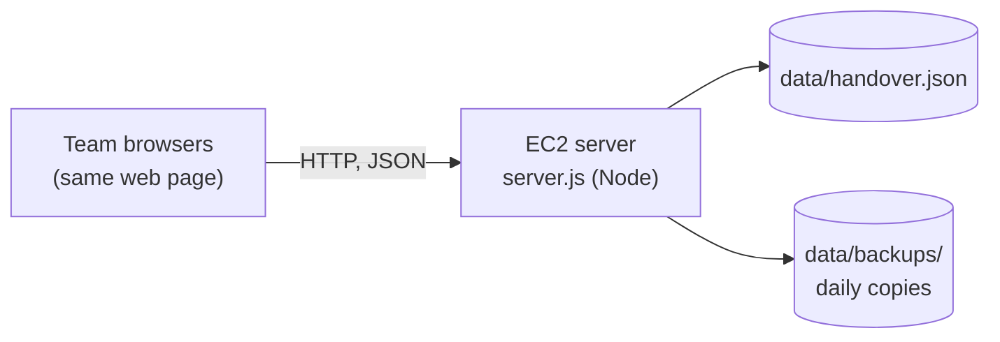
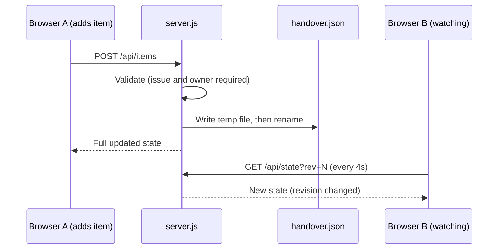

# Shift Handover Tool

A small, shared web app for operations teams to hand work over between shifts.
It replaces long handover pages with a live board: log an item once, the next shift acknowledges it, and old items clean themselves up.


---

## Contents

1. [Why this exists](#why-this-exists)
2. [Features](#features)
3. [Architecture](#architecture)
4. [How a request flows](#how-a-request-flows)
5. [Data model](#data-model)
6. [Shifts](#shifts)
7. [Retention and backups](#retention-and-backups)
8. [API reference](#api-reference)
9. [Project structure](#project-structure)
10. [Configuration](#configuration)
11. [Deploying on AWS (EC2)](#deploying-on-aws-ec2)
12. [Security notes](#security-notes)
13. [Known limitations](#known-limitations)
14. [Roadmap](#roadmap)

---

## Why this exists

Writing handovers as free-text documents is slow, hard to search, and has no retention rules. This tool keeps the same information in a structured, shared list so that:

- writing a handover takes minutes, not a long document
- the incoming shift can see everything in one place and acknowledge it
- items are searchable and grouped by month, day and shift
- old items are removed automatically by priority

---

## Features

| Area | What it does |
| --- | --- |
| Handover items | Ticket number, priority (P1/P2/P3), issue, status, owner, next action for the incoming shift |
| Acknowledge | The incoming person acknowledges an item; who and when is recorded |
| Month, day, shift view | Items are grouped Month, then Day, then Shift, newest first, P1 on top |
| Search and filters | Free-text search plus filters for month, shift, status, owner and priority |
| Team list | A shared list of team names feeds the Owner and Chat dropdowns |
| Live chat | Short tips and updates, shared live, cleared after 24 hours, with pinning |
| Shift summary | One click builds a plain-text summary to paste into Teams or email |
| Retention | Per-priority retention days, enforced automatically |
| Backups | A daily copy of the data file, last 14 kept |
| Light and dark theme | Follows the system setting, with a manual switch |

---

## Architecture

The system has three parts: a web page, one small Node.js server, and one JSON data file. There is no database in this version, on purpose, to keep it simple to run.



| Part | Role |
| --- | --- |
| `public/index.html` | The whole front end: one page with HTML, CSS and JavaScript, no build step |
| `server.js` | Serves the page, exposes a small JSON API, enforces rules, runs cleanup and backups. Uses only built-in Node modules, so there is nothing to `npm install` |
| `data/handover.json` | The single source of truth for items, chat, team names and retention settings |
| `data/backups/` | One copy of the data file per day |

**Live updates** use simple polling. Every 4 seconds the page asks the server for the current revision number. If nothing changed, the server replies `{"same": true}`; otherwise it sends the full state.

**Where data lives:** on the server, in the data file. Nothing important is kept in browsers. The only thing a browser remembers is the last name selected in a dropdown.

---

## How a request flows

Example: adding a P1 item.



Writes go to a temporary file first and are then renamed over the real file, so a crash cannot leave a half-written data file.

---

## Data model

**Item**

| Field | Type | Notes |
| --- | --- | --- |
| `id` | string | Generated by the server |
| `tk` | string | Ticket number, stored upper-case, optional |
| `pr` | `P1` / `P2` / `P3` | Priority |
| `ti` | string | Issue description (required) |
| `st` | string | `Open`, `Monitoring`, `Waiting on client`, `Waiting on vendor`, `Resolved` |
| `ow` | string | Owner (required) |
| `nx` | string | Next action for the incoming shift |
| `created` | number | Epoch milliseconds, set by the server |
| `ack` | object or null | `{ by, at }` once acknowledged |

**Chat message**: `id`, `name`, `text`, `at` (epoch ms, set by the server), `pin` (boolean).

**Other state**: `team` (list of names), `ret` (retention days for `P1`, `P2`, `P3`), `rev` (revision counter that increases on every change).

---

## Shifts

Shift and day are derived from the time an item was created, so nobody picks them by hand.

| Shift | Hours |
| --- | --- |
| A | 06:30 to 14:30 |
| B | 14:30 to 22:30 |
| C | 22:30 to 06:30 |

An item created between 00:00 and 06:30 belongs to the previous day's Shift C, because that shift started the evening before. The calculation uses the viewer's local time zone in the browser.

---

## Retention and backups

| What | Rule |
| --- | --- |
| P1 items | Deleted after 365 days (default) |
| P2 items | Deleted after 90 days (default) |
| P3 items | Deleted after 30 days (default) |
| Chat messages | Deleted after 24 hours |
| Backups | One file per day, last 14 kept |

Retention days can be changed on the page (stored on the server). Cleanup runs when the server starts, every hour, and whenever retention settings change.

Optional extra safety: copy `data/backups/` to an S3 bucket on a schedule (see the deployment section).

---

## API reference

All endpoints return JSON. Any change returns the full updated state, which the page applies directly.

| Method | Path | Purpose |
| --- | --- | --- |
| GET | `/api/state?rev=N` | Current state, or `{"same": true}` if revision `N` is current |
| POST | `/api/items` | Add an item (`ti` and `ow` required) |
| PATCH | `/api/items/:id` | Update fields (`tk`, `ti`, `st`, `ow`, `nx`) or set `ack` |
| DELETE | `/api/items/:id` | Delete an item |
| POST | `/api/chat` | Add a chat message (`name` and `text` required) |
| PATCH | `/api/chat/:id` | Pin or unpin (`{ "pin": true }`) |
| DELETE | `/api/chat/:id` | Delete a message |
| PUT | `/api/team` | Replace the team list (`{ "names": [...] }`, duplicates ignored, case-insensitive) |
| PUT | `/api/ret` | Set retention days (`{ "P1": 365, "P2": 90, "P3": 30 }`, 1 to 3650) |

Anything outside `/api/` returns the web page.

---

## Project structure

```
handover-aws/
  server.js            # server, API, retention, backups
  public/
    index.html         # the whole front end
  handover.service     # systemd unit to keep the server running
  README.md
  data/                # created on first run (not committed)
    handover.json
    backups/
```

---

## Configuration

Set through environment variables.

| Variable | Default | Purpose |
| --- | --- | --- |
| `PORT` | `3000` | Port the server listens on |
| `DATA_FILE` | `./data/handover.json` | Location of the data file (backups go in a `backups` folder next to it) |
| `HANDOVER_USER` | empty | Login username. If empty, there is no login |
| `HANDOVER_PASS` | empty | Login password |

---

## Deploying on AWS (EC2)

Requirements: one small Linux EC2 instance and Node.js 18 or newer.

1. **Launch the instance** inside your company network. In the security group, allow the app port (3000) only from your company IP range or VPN.
2. **Install Node.js**, for example `sudo dnf install -y nodejs` on Amazon Linux, then check `node -v`.
3. **Copy the project** to the machine, for example with `scp -r`.
4. **Test it:**
   ```bash
   cd handover-aws
   HANDOVER_USER=team HANDOVER_PASS=choose-a-password node server.js
   ```
   Open `http://<machine-ip>:3000`, log in, and add a dummy item.
5. **Run it permanently:** edit `handover.service` (password and paths), then:
   ```bash
   sudo cp handover.service /etc/systemd/system/
   sudo systemctl enable --now handover
   sudo systemctl status handover
   ```
6. **Optional S3 backup copy** (the machine needs an IAM role allowed to write to the bucket):
   ```
   0 3 * * * aws s3 sync /home/ec2-user/handover-aws/data/backups s3://YOUR-BUCKET/handover-backups
   ```

**Moving to a new machine:** stop the service, copy the `data` folder across, start the service.

---

## Security notes

- **Do not put real client data in until your security team approves.** Use dummy tickets while piloting.
- Authentication is a single shared username and password (HTTP Basic). Over plain HTTP the password is not encrypted, so keep the app on a private network or VPN, and put HTTPS in front of it (for example a load balancer with a certificate) before real use.
- Change the placeholder password in `handover.service` before starting the service.
- Names in Owner, Acknowledge and Chat are chosen by the user and are not verified per person.
- Keep this repository private and do not commit the `data/` folder.

---

## Known limitations

- One server is one point of failure. Backups protect the data, not the uptime.
- The data file is rewritten on every change, so this suits small teams and modest volumes, not very large datasets.
- Only one server process can safely use the data file at a time.
- Live updates are polling every 4 seconds, not push notifications. There are no phone or email alerts.
- No per-person login and no audit history of edits.
- No integration with ticketing systems yet, so ticket details are typed by hand.

---

## Roadmap

Each step can be done on its own, and the screens stay the same.

1. **HTTPS and single sign-on.** Load balancer with a certificate, company identity login, so Acknowledge records the real person.
2. **Database.** Move storage from the JSON file to Postgres (for example on RDS). Only the load and save layer of the server changes. Enables search at scale, reporting, and an audit table.
3. **Richer retention.** Archive to S3 before deleting, per-client or per-type rules, and a "hold" flag that exempts an item from cleanup.
4. **Ticketing sync.** Scheduled job pulls open incidents from the ticketing system using a read-only account, so only the human notes are typed.
5. **Alerts.** Post the shift summary to Teams automatically and remind the channel about unacknowledged items.
6. **High availability.** Two app servers behind a load balancer with a database that fails over.

---

## Maintainer

_Add name and contact here._
